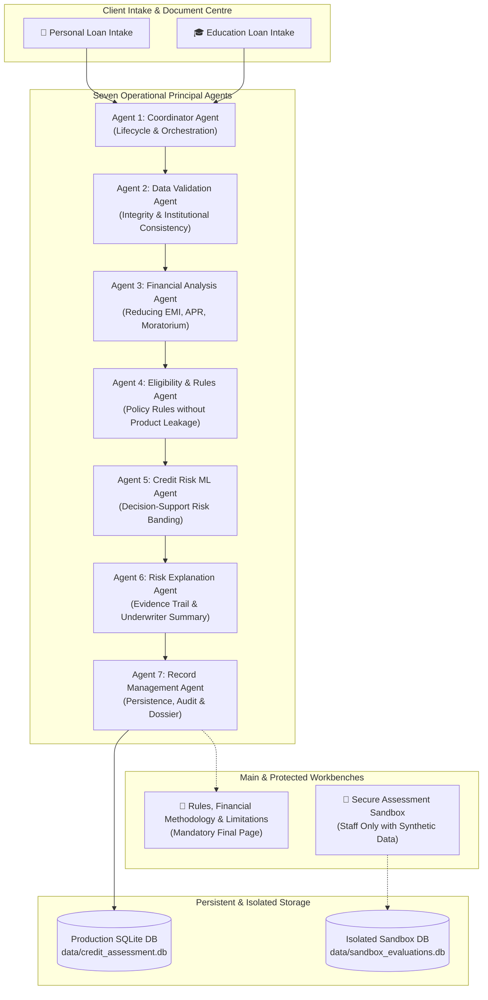

# CreditFlow AI: Multi-Agent AI Credit Assessment & Loan Processing System

[](https://www.python.org/)
[](https://streamlit.io/)
[](https://scikit-learn.org/)
[-success.svg)](https://pytest.org/)
[]()

> ⚠️ **MANDATORY ACADEMIC PROTOTYPE NOTICE**:
> This application is an academic AI-enabled credit assessment and pre-screening prototype. It does NOT constitute a formal loan sanction, legal commitment, credit approval, or RBI endorsement. External identity checks, credit bureau pulls, college accreditation lookups, e-signatures, and funds disbursement operate in simulation mode unless authorized third-party integrations are lawfully configured.

---

## 🌟 Architecture & Core Principles

CreditFlow AI implements a strict, multi-agent automated loan pre-screening and credit assessment architecture for two independent lending products: **Personal Loan** and **Higher Education Loan**.

**Primary Principle:** Automate routine and verified tasks as safely as possible. Escalate applications with suspicious activity, missing or conflicting information, complaints, disputes, policy exceptions, or high-risk scores. Never force every application through automatic processing.



---

## 🤖 The Seven Dedicated Specialized Agents

Each agent is implemented as a standalone class in its own dedicated Python file:

1. **Coordinator Agent** (`agents/coordinator_agent.py`):
   - Generates unique Application IDs (`APP-YYYYMMDD-XXXX`) and workflow trace IDs (`TRC-XXXX`).
   - Sequentially coordinates Agents 2–7.
   - Halts or pauses workflows when data is incomplete; routes failures safely.
   - Propagates selected `loan_product` and `policy_version` without policy cross-leakage.

2. **Data Validation Agent** (`agents/data_validation_agent.py`):
   - Validates applicant fields, data types, permitted age/income ranges.
   - For **Education Loan**: Validates institution name, college address, postal PIN code, and course consistency; enforces co-applicant mandate for loans > ₹4 Lakhs while permitting student pre-course salary = 0.
   - For **Personal Loan**: Enforces verified take-home salary, employer tenure, and debt obligation ranges.
   - Detects duplicate national IDs and conflicting document-to-form values.

3. **Financial Analysis Agent** (`agents/financial_analysis_agent.py`):
   - **Personal Loan**: Computes reducing-balance monthly EMI, net disbursement after upfront fees, all-inclusive APR via Newton-Raphson IRR, and DTI ratio.
   - **Education Loan**: Reconciles itemized educational expenses against confirmed scholarships and student contributions; computes study-period simple interest, balance capitalization, and post-moratorium EMI.

4. **Eligibility and Rules Agent** (`agents/eligibility_rules_agent.py`):
   - Dispatches to `PersonalLoanPolicy.evaluate_rules` or `EducationLoanPolicy.evaluate_rules`.
   - Never evaluates Personal Loan employment rules on student borrowers or vice-versa.
   - Categorizes outcomes into `BLOCKING`, `WARNING`, and `INFO`.

5. **Credit Risk Agent** (`agents/credit_risk_agent.py`):
   - Executes Scikit-Learn ensemble pipeline (`RandomForestClassifier v1.2-academic`).
   - For Education Loans where student salary is zero, evaluates co-applicant earnings profile.
   - If mandatory features or model artifacts are absent, explicitly reports `"Machine-learning risk estimate unavailable"`.

6. **Risk Explanation and Recommendation Agent** (`agents/risk_explanation_agent.py`):
   - Compiles a balanced evidence trail of positive and negative factors.
   - Assigns safe preliminary outcomes:
     `PROCEED_TO_NEXT_STAGE`, `REQUIRES_HUMAN_REVIEW`, `MORE_INFORMATION_REQUIRED`, or `ON_HOLD_FOR_VERIFICATION`.
   - Generates an underwriter rationale summary for human credit committees.

7. **Final Record Management Agent** (`agents/record_management_agent.py`):
   - Persists all applicant details, financial calculations, and agent traces transactionally into SQLite (`data/credit_assessment.db`).
   - Records an immutable audit log for every execution step.
   - Appends the mandatory **"Rules, Financial Methodology & Limitations"** as the final section of every generated assessment dossier.

---

## 📑 Two Independent Loan Products

### Product 1: Unsecured Personal Loan
- **Target**: Salaried & Professional Individuals
- **Debt Ceiling**: Maximum 55% DTI on Net Take-Home Earnings
- **Checklist**: Identity Proof, Address Proof, Photograph, 3-Month Salary Slips, 6-Month Bank Statements, Form 16 / ITR.
- **Key Formulas**:
  $$\text{EMI} = \frac{P \cdot r \cdot (1 + r)^n}{(1 + r)^n - 1}$$
  $$\text{APR} = r_{\text{monthly}} \cdot 12 \cdot 100 \quad \text{where} \quad \text{Net Disbursed} = \sum_{t=1}^{n} \frac{\text{EMI}}{(1 + r_{\text{monthly}})^t}$$

### Product 2: Higher Education Loan
- **Target**: Undergraduate & Postgraduate Students (Domestic & Overseas)
- **Student Salary**: Evaluated independently (zero salary permitted without penalty)
- **Co-Applicant Mandate**: Mandatory joint-borrower guarantee for loans exceeding ₹4 Lakhs (under IBA Model Scheme)
- **Checklist**: Offer / Admission Letter, Institutional Fee Structure, Academic Marksheets, Entrance Exam Scorecard, Student KYC, Co-Applicant KYC, Co-Applicant Income Proof, Scholarship Award Letter.
- **Key Formulas**:
  $$\text{Indicative Financing} = \text{Declared Eligible Costs} - \text{Confirmed Scholarships} - \text{Student Contribution}$$
  $$\text{Study-Period Interest} = P \cdot \left(\frac{\text{Rate}}{100}\right) \cdot \left(\frac{\text{Moratorium Months}}{12}\right)$$
  $$\text{Capitalized Principal} = P + \text{Study-Period Interest}$$

---

## 🔄 12-State Document Lifecycle

Every document in the product checklists transitions through a clear 12-state lifecycle:
1. `Not Uploaded`
2. `Uploaded`
3. `File Validation Failed`
4. `Extraction Pending`
5. `Extraction Completed`
6. `Awaiting Applicant Confirmation`
7. `Missing Information`
8. `Mismatch Detected`
9. `Re-upload Required`
10. `Awaiting Authorized Verification`
11. `Verified Through Authorized Integration`
12. `Human Review Required`

---

## 📜 Final Page: Rules, Financial Methodology & Limitations

The dedicated page appears as the **final item in main navigation** and as the **final section of generated assessment reports**. It contains six sections:
1. **Which rules were used?**: Separated into 4 strict categories:
   - *Tier 1: Applicable Regulatory Requirements* (RBI Digital Lending Guidelines 2022, IBA Model Scheme, Fair Practices Code)
   - *Tier 2: Authorized Lender Policy* (55% DTI ceiling, age limits, co-applicant mandates)
   - *Tier 3: Selected Loan-Product Terms* (Rate types, amortization, fees)
   - *Tier 4: Academic Demonstration Assumptions* (Synthetic boundaries)
2. **Financial calculation methodology**: Complete formulas, conventions, rounding rules, APR IRR solving, and versioning (`FinancialEngine-v2.4`).
3. **Financial assumptions & scenarios**: Disclosed baselines with notice: *"Estimate — not a contractual offer."*
4. **Model methodology**: Random Forest metrics (ROC-AUC: 0.88), training data disclosure, missing-data treatment, and explanation of why AI cannot make the final lending decision.
5. **Limitations & exclusions**: Transparently lists pending external verifications and demo boundaries.
6. **Audit & reproducibility**: Staff-only console displaying engine versions, system controls, and a deterministic calculation reproduction tool.

---

## 🧪 Secure Assessment Sandbox & Isolation

Accessible only to authorized staff (`Credit Officer`, `Fraud Investigator`, `Administrator`):
- **Mandatory Banner**:
  > `SECURE TEST ENVIRONMENT — Use synthetic data only. Results are for testing and preliminary assessment. This environment does not sanction or disburse loans.`
- **Strict Data Isolation**: Uses separate SQLite database (`data/sandbox_evaluations.db`). Sandbox scenarios and fault injections never contaminate real applicant intake data.
- **Simulation Capabilities**:
  - Test pre-configured synthetic benchmarks (Prime Salaried, Overleveraged, Premier STEM, Missing Co-Applicant).
  - Select document verification states from the 12 lifecycle states.
  - Fault injection: Simulate bureau 503 gateway outages, simulate offline ML models, and inject input conflicts.
  - Inspect agent-by-agent execution waterfall, download synthetic dossiers, and purge test data safely.

---

## 🛡️ Role-Based Access Control (RBAC)

| Role | Accessible Workbenches | Permissions |
| :--- | :--- | :--- |
| **Applicant** | Dashboard, New Application, Applications (Own cases), Document Uploads, Grievance Disputes, Public Methodology | Submit applications, upload own documents, track own case status |
| **Credit Officer** | All applicant workbenches + Human Review Queue, Agent Logs, Analytics, Staff Methodology Audit, **Secure Sandbox** | Review cases, make underwriting recommendations, test scenarios in sandbox |
| **Fraud Investigator**| All applicant workbenches + Fraud Investigation Desk, Document Tampering Inspector, Staff Methodology Audit, **Secure Sandbox** | Investigate fraud flags, inspect duplicate records, simulate compromised inputs |
| **Administrator** | Full system access + System Configuration, Database Purging, Audit Log Review | Manage policy configurations, audit trails, and sandbox resets |

---

## 🚀 Running the Application & Test Suite

### 1. Start the Streamlit Application
```powershell
python -m streamlit run app.py --server.port 8501
```
Open your browser at `http://localhost:8501`.

### 2. Run the Acceptance Test Suite (All 45 Tests)
```powershell
python -m pytest tests/ -v
```

### 3. Run Section G Acceptance Suite Only (Criteria 1–18)
```powershell
python -m pytest tests/test_final_specification.py -v
```

---

## 📊 Summary of Acceptance Test Results

All 45 tests pass with 100% success rate:
- `tests/test_final_specification.py`: **18 passed** (Items 1–18 directly verified)
- `tests/test_agents.py`: **7 passed** (Agent unit evaluations, EMI formulas, zero interest, ML bounds)
- `tests/test_workflow.py`: **5 passed** (End-to-end sequential orchestrator waterfalls, pauses, disputes)
- `tests/test_database.py`: **6 passed** (SQLite WAL schema, foreign keys, transaction rollbacks)
- `tests/test_security.py`: **6 passed** (Byte header validation, malicious executable rejection, size boundaries)
- `tests/test_documents.py`: **3 passed** (PDF text extraction, synthetic entity matching)

---

## 📋 List of Unresolved Compliance & Production-Readiness Requirements

While CreditFlow AI demonstrates a fully working automated pre-screening engine, the following real-world requirements remain before deploying to live banking production:

1. **Live Account Aggregator (RBI-AA) Integration**:
   - *Current State*: Local PDF bank statement parsing.
   - *Production Requirement*: Certified FIP/FIU integration with an authorized RBI Account Aggregator (e.g. Setu, Finvu, OneMoney) with cryptographically signed consent tokens.

2. **Authorized Credit Information Company (CIC) Gateway**:
   - *Current State*: Synthetic credit scores and simulator tokens.
   - *Production Requirement*: Licensed commercial API connection with CIBIL, Experian, Equifax, or CRIF High Mark adhering to the Credit Information Companies (Regulation) Act, 2005.

3. **Central KYC Registry (CKYCR) & UIDAI Aadhaar Vault**:
   - *Current State*: Masked synthetic ID entity extraction.
   - *Production Requirement*: Hardware Security Module (HSM) protected Aadhaar Vault and certified CKYCR API gateway for official e-KYC.

4. **Independent College Accreditation Directory**:
   - *Current State*: Structural PIN code, postal zone, and admission letter format validation.
   - *Production Requirement*: Live registry feed with AISHE (Ministry of Education), UGC, AICTE, and international SEVIS / UKVI authorized institution databases.

5. **Hardware Security Module (HSM) & Production KMS**:
   - *Current State*: Environment variable and local configuration management.
   - *Production Requirement*: Cloud HSM (AWS CloudHSM, Azure Key Vault, or HashiCorp Vault) for field-level database encryption at rest.

6. **Formal Model Risk Governance (MRM)**:
   - *Current State*: Random Forest trained on 5,000 synthetic Indian demographic credit profiles (ROC-AUC: 0.88).
   - *Production Requirement*: Longitudinal calibration on audited historical default portfolios, quarterly drift monitoring (PSI/CSI), and formal validation by an independent Model Risk Committee.
